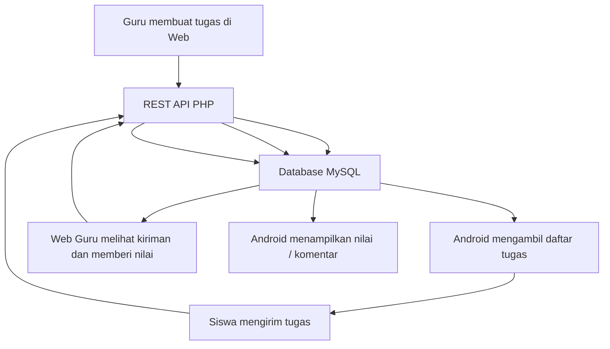

# Product Requirements Document (PRD)
## TugasKu — Sistem Pengumpulan Tugas Sekolah

- **Versi:** 1.2
- **Status:** Draft proyek sekolah
- **Platform:** Aplikasi Android khusus siswa + Website panel khusus guru
- **Acuan UI:** Google Drive sebagai referensi pola antarmuka (bukan menyalin merek atau aset)

---

## 1. Ringkasan Produk

**TugasKu** adalah sistem pengumpulan tugas sekolah yang terdiri dari dua platform dan wajib saling terhubung:

1. **Aplikasi Android untuk siswa:** siswa melihat tugas yang diberikan guru, membaca instruksi dan tenggat, mengumpulkan jawaban dalam bentuk file/gambar/teks, serta melihat status, nilai, dan komentar.
2. **Website untuk guru saja:** guru membuat dan mengelola tugas, melihat daftar pengumpulan siswa, membuka atau mengunduh kiriman, serta memberikan nilai dan umpan balik.

Kedua platform memakai **satu backend/API PHP** dan **satu database MySQL**. File tugas dan kiriman disimpan pada penyimpanan server yang sama. Dengan demikian, tugas yang dibuat guru di web akan tampil pada aplikasi siswa, sedangkan kiriman dari aplikasi siswa akan langsung tersedia di panel guru setelah tersimpan di server.

> **Batas platform wajib:** Android hanya untuk siswa. Website hanya untuk guru. Tidak dibuat website siswa, website wali kelas, atau website admin. Data awal akun, siswa, guru, kelas, dan mata pelajaran untuk MVP disiapkan melalui database/seed data oleh pengelola teknis proyek.

---

## 2. Latar Belakang dan Masalah

Pengumpulan tugas melalui chat atau media yang tersebar membuat file sulit dicari, status pengumpulan tidak jelas, dan guru kesulitan memeriksa tugas. TugasKu menyediakan satu sistem terpusat agar:

- Siswa bisa menemukan tugas dan mengirimkannya melalui satu aplikasi.
- Guru dapat mengelola tugas dan memeriksa kiriman dari satu panel web.
- Riwayat pengumpulan, tenggat, nilai, dan komentar tersimpan terstruktur.
- Informasi pada Android dan web selalu bersumber dari database yang sama.

---

## 3. Tujuan Produk

1. Memudahkan siswa mengumpulkan tugas dalam bentuk file, gambar, dan teks.
2. Memudahkan guru membuat tugas, memeriksa kiriman, serta memberikan nilai dan komentar.
3. Menyediakan sinkronisasi data antara Android siswa dan web guru.
4. Menggunakan database MySQL melalui backend/API sehingga file dan metadata tidak tersimpan hanya di perangkat.
5. Menghadirkan UI bersih dan familiar dengan pola pengelolaan file seperti Google Drive.

---

## 4. Pengguna, Platform, dan Hak Akses

### 4.1 Siswa — Android
Siswa menggunakan aplikasi Android untuk:
- Login dan logout.
- Melihat daftar tugas sesuai kelasnya.
- Mencari dan memfilter tugas.
- Membuka instruksi dan lampiran tugas.
- Mengumpulkan file, foto/gambar, jawaban teks, atau kombinasi teks dan file.
- Melihat status pengumpulan, waktu pengumpulan, nilai, dan komentar guru.
- Melihat riwayat tugas dan mengubah profil dasar yang diizinkan.

### 4.2 Guru — Website
Guru menggunakan website panel guru untuk:
- Login dan logout.
- Melihat ringkasan tugas serta pengumpulan.
- Membuat, mengedit, menerbitkan, dan mengarsipkan tugas.
- Memilih kelas dan mata pelajaran yang sudah terdaftar untuk guru tersebut.
- Menambahkan instruksi dan lampiran pada tugas.
- Melihat daftar siswa yang sudah/belum mengumpulkan.
- Membuka pratinjau atau mengunduh kiriman siswa.
- Memberikan nilai, komentar, dan status perlu revisi.

### 4.3 Matriks Hak Akses

| Fitur | Android Siswa | Web Panel Guru |
| :--- | :---: | :---: |
| Login dan logout | Ya | Ya |
| Melihat/mengubah profil sendiri | Ya | Ya |
| Melihat tugas sesuai kelas/mata pelajaran | Ya | Ya, untuk tugas yang diajar |
| Mengumpulkan tugas | Ya | Tidak |
| Membuat/mengedit tugas | Tidak | Ya |
| Melihat dan mengunduh kiriman siswa | Tidak | Ya |
| Memberi nilai dan komentar | Tidak | Ya |
| Melihat status pengumpulan | Milik sendiri | Semua siswa pada tugas yang diajar |

> **Catatan Keamanan:** Backend wajib memeriksa role dan kepemilikan data pada setiap permintaan. Menyembunyikan tombol di UI saja tidak dianggap sebagai pengamanan.

---

## 5. Ruang Lingkup

### 5.1 MVP — Wajib Dibangun

#### Aplikasi Android siswa:
- Halaman pembuka/welcome dan login.
- Dashboard siswa.
- Daftar, pencarian, filter, dan detail tugas.
- Form pengumpulan file, gambar, dan teks.
- Validasi file dan indikator progres upload.
- Bukti serta riwayat pengumpulan.
- Tampilan status, nilai, dan komentar guru.
- Profil siswa.

#### Website panel guru:
- Halaman pembuka/welcome dan login guru.
- Dashboard ringkasan tugas/pengumpulan.
- Daftar tugas dengan tampilan list/grid.
- Form buat/edit tugas dan lampiran instruksi.
- Detail tugas dan daftar kiriman siswa.
- Pratinjau/unduh file kiriman.
- Form nilai, komentar, dan status revisi.
- Profil guru dan logout.

#### Backend bersama:
- REST API PHP.
- Database MySQL.
- Autentikasi dan otorisasi role siswa/guru.
- Penyimpanan file terpusat.
- Sinkronisasi data Android dan web.

### 5.2 Di Luar Ruang Lingkup Versi Ini
- Website khusus siswa.
- Website admin sekolah.
- Website wali kelas.
- Modul CRUD akun/kelas/mata pelajaran melalui dashboard admin.
- Chat langsung, deteksi plagiarisme, integrasi kalender, dan login Google.
- Mode offline dan sinkronisasi tertunda.
- Notifikasi push otomatis (dapat menjadi pengembangan berikutnya).

> Data awal akun, kelas, siswa, guru, dan mata pelajaran diisikan melalui database/seed data untuk MVP. Jika dibutuhkan halaman pengelolaan data tersebut, itu merupakan pengembangan ruang lingkup berikutnya, bukan bagian panel guru saat ini.

---

## 6. Alur Pengguna Utama

### 6.1 Guru Membuat Tugas
1. Guru membuka website panel guru dan login.
2. Guru memilih menu **Tugas Saya** lalu menekan **Buat Tugas**.
3. Guru mengisi judul, instruksi, mata pelajaran, kelas tujuan, dan tenggat.
4. Guru dapat menambahkan lampiran instruksi.
5. Guru menyimpan sebagai draf atau menerbitkan tugas.
6. Backend menyimpan data ke MySQL.
7. Tugas yang diterbitkan akan muncul di aplikasi Android siswa yang sesuai kelasnya.

### 6.2 Siswa Mengumpulkan Tugas
1. Siswa membuka aplikasi Android dan login.
2. Dashboard menampilkan tugas yang ditujukan kepada kelas siswa.
3. Siswa membuka detail tugas dan membaca instruksi serta tenggat.
4. Siswa menekan **Kumpulkan Tugas**.
5. Siswa memilih file, mengambil/memilih gambar, menulis jawaban teks, atau menggabungkannya.
6. Siswa memeriksa ringkasan lalu menekan **Kirim**.
7. Android mengirim data ke REST API. Backend memvalidasi file, menyimpan file di storage server, dan menyimpan metadata ke MySQL.
8. Aplikasi menampilkan bukti pengumpulan dan status berhasil.
9. Kiriman tersebut muncul pada daftar pengumpulan di panel guru.

### 6.3 Guru Memeriksa Kiriman
1. Guru membuka tugas pada website.
2. Guru melihat jumlah siswa yang sudah mengumpulkan, belum mengumpulkan, terlambat, atau perlu revisi.
3. Guru membuka kiriman siswa dan melihat pratinjau bila format didukung, atau mengunduh file.
4. Guru memberi nilai dan komentar.
5. Guru menyimpan dan memublikasikan hasil pemeriksaan.
6. Aplikasi Android siswa menampilkan nilai dan komentar tersebut.

### 6.4 Alur Sinkronisasi



> **Prinsip Utama:** Tidak boleh ada database terpisah untuk Android dan web. Keduanya membaca dan menulis data utama melalui backend yang sama.

---

## 7. Persyaratan Fungsional

### 7.1 Autentikasi dan Profil
- **FR-001:** Android dan web menampilkan halaman sambutan sebelum login.
- **FR-002:** Siswa dan guru dapat login menggunakan akun yang telah disiapkan.
- **FR-003:** Akun siswa hanya dapat digunakan pada aplikasi Android; akun guru hanya dapat digunakan pada website panel guru.
- **FR-004:** Pengguna dapat logout.
- **FR-005:** Kata sandi disimpan dalam bentuk hash aman, bukan teks biasa.
- **FR-006:** Akun awal siswa dan guru disiapkan melalui database/seed data; panel admin tidak termasuk.
- **FR-007:** Siswa dapat melihat dan mengubah profil yang diizinkan, misalnya foto dan nomor telepon.
- **FR-008:** Data penting seperti NIS/NISN dan kelas tidak dapat diubah oleh siswa.
- **FR-009:** Guru dapat mengubah data profil miliknya sendiri.

### 7.2 Pengelolaan Tugas oleh Guru
- **FR-010:** Guru dapat membuat tugas dengan judul, instruksi, kelas tujuan, mata pelajaran, tenggat, dan lampiran opsional.
- **FR-011:** Guru dapat menyimpan tugas sebagai draf atau menerbitkannya.
- **FR-012:** Tugas yang berstatus draf tidak terlihat oleh siswa.
- **FR-013:** Guru dapat mengedit atau mengarsipkan tugas yang dibuatnya.
- **FR-014:** Guru hanya dapat memilih kelas dan mata pelajaran yang telah ditautkan ke akun guru tersebut.
- **FR-015:** Siswa hanya melihat tugas yang ditujukan ke kelasnya.

### 7.3 Pengumpulan oleh Siswa
- **FR-016:** Siswa dapat mengirim satu atau beberapa lampiran sesuai konfigurasi.
- **FR-017:** Format awal yang didukung: PDF, DOC, DOCX, XLS, XLSX, PPT, PPTX, JPG, JPEG, dan PNG.
- **FR-018:** Siswa dapat mengirim jawaban teks tanpa lampiran.
- **FR-019:** Siswa dapat menggabungkan jawaban teks dengan lampiran.
- **FR-020:** Sistem memvalidasi ekstensi, MIME type, dan ukuran file di server.
- **FR-021:** Batas ukuran awal yang disarankan adalah 20 MB per file.
- **FR-022:** Waktu pengumpulan dicatat berdasarkan waktu server.
- **FR-023:** Kiriman setelah tenggat ditandai Terlambat.
- **FR-024:** Pengumpulan ulang dapat diizinkan atau ditolak sesuai pengaturan tugas dari guru.
- **FR-025:** Riwayat versi pengumpulan disimpan jika siswa mengirim ulang.
- **FR-026:** Setelah berhasil mengirim, siswa memperoleh status/bukti pengumpulan.

### 7.4 Pemeriksaan dan Penilaian oleh Guru
- **FR-027:** Guru dapat melihat daftar pengumpulan untuk tugas yang dibuatnya.
- **FR-028:** Guru dapat membuka atau mengunduh lampiran kiriman siswa.
- **FR-029:** Guru dapat memberikan nilai numerik sesuai skala yang ditentukan sekolah.
- **FR-030:** Guru dapat memberikan komentar dan mengubah status menjadi Dinilai atau Perlu Revisi.
- **FR-031:** Siswa dapat melihat nilai dan komentar yang telah dipublikasikan.

### 7.5 Integrasi Android-Web
- **FR-032:** Tugas yang diterbitkan guru di web muncul di aplikasi siswa yang termasuk kelas tujuan.
- **FR-033:** Pengumpulan dari Android muncul di panel guru setelah backend berhasil menyimpannya.
- **FR-034:** Nilai dan komentar yang disimpan guru dapat dibaca siswa melalui aplikasi Android.
- **FR-035:** Kedua platform menggunakan endpoint API dan database MySQL yang sama.
- **FR-036:** Sistem mencatat aktivitas penting seperti pembuatan tugas, pengumpulan, dan penilaian.

---

## 8. Persyaratan Desain UI/UX

### 8.1 Arah Visual
UI mengambil inspirasi dari **Google Drive**: sederhana, lapang, berorientasi pada pencarian dan daftar file. TugasKu tetap harus memiliki logo, nama, warna, dan ikon sendiri.

- Latar utama abu-abu sangat muda atau putih (`#F8F9FA` / `#FFFFFF`).
- Permukaan kartu putih dengan border tipis dan radius sedang (`border border-gray-200 rounded-lg`).
- Warna biru sebagai warna aksi utama (`#1A73E8` / `#2563EB`).
- Tipografi sans-serif yang jelas dan mudah dibaca (Inter / Plus Jakarta Sans).
- Ikon file dibedakan untuk PDF, dokumen, spreadsheet, presentasi, dan gambar.
- Status selalu ditulis sebagai teks, tidak hanya dibedakan melalui warna.
- Sediakan loading, empty state, error state, upload progress, dan konfirmasi sukses.

### 8.2 Website Panel Guru — Pola Google Drive

| Area | Komponen | Perilaku |
| :--- | :--- | :--- |
| **Header atas** | Logo TugasKu, search bar, notifikasi opsional, avatar guru | Pencarian tugas dan akses profil |
| **Sidebar kiri** | Beranda, Tugas Saya, Pengumpulan | Navigasi utama guru |
| **Area konten** | Judul halaman, breadcrumb, filter, list/grid | Menampilkan tugas atau kiriman |
| **Tombol utama** | Buat Tugas (+ ikon plus) | Membuka form pembuatan tugas |
| **Daftar tugas** | Ikon, judul, kelas, mapel, tenggat, status, menu aksi | Mendukung pencarian dan sortir |
| **Detail pengumpulan** | Nama siswa, waktu, status, file, nilai | Membuka dan menilai kiriman |

> Tampilan desktop menjadi prioritas karena guru lebih nyaman memeriksa banyak file melalui laptop. Web tetap responsif untuk tablet dan layar ponsel.

### 8.3 Aplikasi Android Siswa — Adaptasi Mobile
- **Top app bar:** logo/nama TugasKu, pencarian, dan avatar.
- **Dashboard:** sapaan dan ringkasan tugas yang belum dikumpulkan.
- **Filter cepat:** Semua, Belum Dikumpulkan, Sudah Dikumpulkan, Dinilai.
- **Daftar tugas:** judul, mata pelajaran, guru, tenggat, dan status.
- **Detail tugas:** instruksi, lampiran guru, tenggat, dan tombol Kumpulkan Tugas.
- **Form pengumpulan:** pilihan file, kamera/galeri, dan kolom jawaban teks.
- **Bottom navigation:** Beranda, Tugas, Tugas Saya, Profil.

### 8.4 Daftar Layar Minimum

#### Android Siswa:
1. Splash screen.
2. Welcome/onboarding.
3. Login.
4. Beranda.
5. Daftar tugas.
6. Detail tugas.
7. Form pengumpulan file/gambar/teks.
8. Pratinjau dan konfirmasi pengiriman.
9. Status dan riwayat tugas.
10. Detail hasil penilaian.
11. Profil dan edit profil.

#### Web Panel Guru:
1. Welcome/login guru.
2. Dashboard.
3. Daftar tugas.
4. Buat/edit tugas.
5. Detail tugas dan ringkasan pengumpulan.
6. Daftar pengumpulan siswa.
7. Detail kiriman/pratinjau/unduh.
8. Penilaian dan komentar.
9. Profil dan logout.

> Tidak dibuat halaman web untuk siswa, wali kelas, atau admin.

---

## 9. Model Database

Database relasional MySQL:

### 9.1 `users`
- `id` (PK, INT AUTO_INCREMENT)
- `name` (VARCHAR(150))
- `username` (VARCHAR(100), UNIQUE)
- `email` (VARCHAR(150), UNIQUE, nullable)
- `password_hash` (VARCHAR(255))
- `role` (ENUM('student', 'teacher'))
- `phone` (VARCHAR(20), nullable)
- `photo_path` (VARCHAR(255), nullable)
- `is_active` (TINYINT(1), DEFAULT 1)
- `created_at`, `updated_at` (DATETIME / TIMESTAMP)

### 9.2 `students`
- `id` (PK, INT AUTO_INCREMENT)
- `user_id` (FK → `users.id`, UNIQUE)
- `student_number` (VARCHAR(50) — NIS/NISN, UNIQUE)
- `class_id` (FK → `classes.id`)

### 9.3 `teachers`
- `id` (PK, INT AUTO_INCREMENT)
- `user_id` (FK → `users.id`, UNIQUE)
- `nip` (VARCHAR(50), nullable)

### 9.4 `classes`
- `id` (PK, INT AUTO_INCREMENT)
- `name` (VARCHAR(50) — misal "X RPL 1")
- `academic_year` (VARCHAR(20) — misal "2024/2025")

### 9.5 `subjects`
- `id` (PK, INT AUTO_INCREMENT)
- `name` (VARCHAR(100) — misal "Pemrograman Web")
- `code` (VARCHAR(20), nullable — misal "PW-01")

### 9.6 `teacher_subject_classes`
- `id` (PK, INT AUTO_INCREMENT)
- `teacher_id` (FK → `teachers.id`)
- `subject_id` (FK → `subjects.id`)
- `class_id` (FK → `classes.id`)
*(Menentukan kelas dan mata pelajaran yang boleh dikelola oleh guru)*

### 9.7 `assignments`
- `id` (PK, INT AUTO_INCREMENT)
- `teacher_id` (FK → `teachers.id`)
- `subject_id` (FK → `subjects.id`)
- `class_id` (FK → `classes.id`)
- `title` (VARCHAR(200))
- `description` (TEXT)
- `due_at` (DATETIME)
- `status` (ENUM('draft', 'published', 'archived'), DEFAULT 'draft')
- `allow_resubmission` (TINYINT(1), DEFAULT 1)
- `created_at`, `updated_at` (TIMESTAMP)

### 9.8 `assignment_attachments`
- `id` (PK, INT AUTO_INCREMENT)
- `assignment_id` (FK → `assignments.id`)
- `original_name` (VARCHAR(255))
- `stored_name` (VARCHAR(255))
- `mime_type` (VARCHAR(100))
- `size_bytes` (BIGINT)
- `storage_path` (VARCHAR(255))
- `uploaded_at` (TIMESTAMP)

### 9.9 `submissions`
- `id` (PK, INT AUTO_INCREMENT)
- `assignment_id` (FK → `assignments.id`)
- `student_id` (FK → `students.id`)
- `answer_text` (TEXT, nullable)
- `submitted_at` (DATETIME)
- `status` (ENUM('submitted', 'late', 'graded', 'revision_requested'))
- `version_number` (INT, DEFAULT 1)
- `created_at`, `updated_at` (TIMESTAMP)

### 9.10 `submission_files`
- `id` (PK, INT AUTO_INCREMENT)
- `submission_id` (FK → `submissions.id`)
- `original_name` (VARCHAR(255))
- `stored_name` (VARCHAR(255))
- `mime_type` (VARCHAR(100))
- `size_bytes` (BIGINT)
- `storage_path` (VARCHAR(255))
- `uploaded_at` (TIMESTAMP)

### 9.11 `grades`
- `id` (PK, INT AUTO_INCREMENT)
- `submission_id` (FK → `submissions.id`, UNIQUE)
- `teacher_id` (FK → `teachers.id`)
- `score` (DECIMAL(5,2))
- `feedback` (TEXT, nullable)
- `published_at` (DATETIME, nullable)
- `created_at`, `updated_at` (TIMESTAMP)

### 9.12 `activity_logs`
- `id` (PK, INT AUTO_INCREMENT)
- `user_id` (FK → `users.id`, nullable)
- `action` (VARCHAR(100))
- `entity_type` (VARCHAR(50))
- `entity_id` (INT)
- `metadata` (JSON, nullable)
- `created_at` (TIMESTAMP)

### 9.13 Aturan Relasi
1. Satu akun siswa terhubung ke satu data siswa dan satu kelas aktif.
2. Satu akun guru terhubung ke satu data guru.
3. Satu tugas pada MVP ditujukan ke satu kelas dan satu mata pelajaran.
4. Guru hanya dapat membuat tugas untuk kombinasi kelas/mata pelajaran yang terdaftar pada `teacher_subject_classes`.
5. Satu siswa dapat memiliki beberapa versi pengumpulan untuk satu tugas jika pengumpulan ulang diizinkan.
6. File disimpan di storage server; database hanya menyimpan metadata dan path internal.
7. Akun yang dinonaktifkan tidak menghapus riwayat tugas dan pengumpulan.
8. Terapkan foreign key dan indeks pada `class_id`, `assignment_id`, `student_id`, `role`, dan `due_at`.

---

## 10. Rancangan Teknologi dan Arsitektur

| Lapisan | Teknologi yang disarankan |
| :--- | :--- |
| **Android** | Android Studio, Java, XML layout, Retrofit/OkHttp |
| **Website Guru** | PHP 8+, HTML, CSS, JavaScript, Tailwind/Bootstrap |
| **Database** | MySQL / MariaDB |
| **Server Lokal** | XAMPP (Apache + MySQL + PHP 8.2) |
| **Komunikasi** | REST API berbasis JSON |
| **Upload File** | Multipart form-data ke endpoint backend |
| **Version Control** | Git |

### 10.1 Arsitektur Tingkat Tinggi

```text
Android App (Siswa) ───────┐
                           ├── REST API (PHP) ─── MySQL Database
Web Panel (Guru) ──────────┘          │
                                      └── File Storage (folder privat server /uploads/)
```

### 10.2 Kelompok Endpoint API

- `POST /api/auth/login`
- `POST /api/auth/logout`
- `GET /api/me`
- `PATCH /api/me/profile`
- `GET /api/assignments` (siswa: tugas kelasnya; guru: tugas yang dibuatnya)
- `GET /api/assignments/{id}`
- `POST /api/assignments` (guru)
- `PATCH /api/assignments/{id}` (guru)
- `POST /api/assignments/{id}/publish` (guru)
- `GET /api/assignments/{id}/submissions` (guru)
- `POST /api/assignments/{id}/submissions` (siswa, multipart)
- `GET /api/my-submissions` (siswa)
- `GET /api/submissions/{id}/files/{fileId}` (akses terotorisasi)
- `POST /api/submissions/{id}/grade` (guru)

> Setiap endpoint harus memeriksa autentikasi, role, kepemilikan tugas, dan relasi kelas sebelum membaca atau mengubah data.

---

## 11. Keamanan dan Privasi

1. Gunakan HTTPS saat dipasang pada server publik.
2. Simpan kata sandi menggunakan password hashing yang kuat (`password_hash()` dengan `PASSWORD_BCRYPT` atau `PASSWORD_ARGON2ID`).
3. Validasi ekstensi, MIME type, dan ukuran file di server.
4. Buat nama file acak (UUID/hash); jangan menggunakan nama asli sebagai path penyimpanan.
5. Simpan file pada direktori privat/non-executable. Unduhan wajib melalui endpoint yang memeriksa hak akses.
6. Gunakan prepared statements/PDO untuk mencegah SQL injection dan escaping output untuk mencegah XSS.
7. Terapkan CSRF protection untuk sesi web berbasis cookie.
8. Batasi percobaan login (rate limiting sederhana).
9. Siswa hanya boleh melihat data dan file miliknya serta tugas untuk kelasnya.
10. Guru hanya boleh mengakses tugas dan kiriman dari kelas/mata pelajaran yang menjadi tanggung jawabnya.
11. Jangan menampilkan data pribadi siswa secara publik atau menggunakan URL file yang mudah ditebak.

---

## 12. Persyaratan Nonfungsional

- **NFR-001 Responsif:** Android nyaman digunakan pada ponsel; web panel guru dioptimalkan untuk laptop dan tetap responsif pada tablet/ponsel.
- **NFR-002 Performa:** daftar panjang memakai pagination; dashboard diupayakan tampil sekitar 3 detik pada jaringan lokal normal.
- **NFR-003 Keandalan:** kegagalan upload tidak boleh ditandai sebagai berhasil; sediakan pesan error dan opsi coba lagi.
- **NFR-004 Konsistensi:** tugas, kiriman, nilai, dan komentar yang tersimpan di server dapat dibaca kedua platform sesuai hak akses.
- **NFR-005 Kemudahan:** alur pengumpulan tugas dibuat singkat dan mudah dipahami siswa.
- **NFR-006 Kompatibilitas:** web mendukung browser modern; versi Android minimum ditetapkan saat implementasi (Android 8.0+ / API 26).
- **NFR-007 Backup:** database dan folder file memiliki prosedur pencadangan.
- **NFR-008 Maintainability:** kode dipisah per modul, konfigurasi rahasia tidak ditanam di source code, dan endpoint didokumentasikan.

---

## 13. Aturan Bisnis

1. Siswa hanya dapat mengumpulkan tugas yang ditujukan ke kelasnya.
2. Tugas berstatus draf tidak ditampilkan pada aplikasi siswa.
3. Zona waktu tenggat menggunakan `Asia/Jakarta`.
4. Kiriman yang diterima setelah tenggat ditandai **Terlambat**.
5. Guru hanya dapat menilai kiriman untuk tugas yang dibuatnya.
6. Nilai dan komentar baru terlihat di Android setelah dipublikasikan guru.
7. Pengumpulan ulang mengikuti pengaturan pada tugas dan harus mempertahankan riwayat versi.
8. Pengguna tidak dapat mengakses file milik pengguna lain tanpa hak akses.

---

## 14. Kriteria Penerimaan

### Android Siswa
- [ ] Siswa dapat login di aplikasi Android.
- [ ] Siswa hanya melihat tugas yang sesuai dengan kelasnya.
- [ ] Siswa dapat membuka detail dan lampiran instruksi tugas.
- [ ] Siswa dapat mengirim file yang diizinkan.
- [ ] Siswa dapat mengirim gambar.
- [ ] Siswa dapat mengirim jawaban teks tanpa file.
- [ ] Siswa dapat mengirim teks dan lampiran sekaligus.
- [ ] File dengan format atau ukuran terlarang ditolak dengan pesan jelas.
- [ ] Setelah berhasil, tugas muncul pada riwayat dengan waktu dan status yang benar.
- [ ] Siswa dapat melihat nilai dan komentar yang dipublikasikan guru.

### Web Panel Guru
- [ ] Guru dapat login di website.
- [ ] Guru dapat membuat dan menerbitkan tugas untuk kelas/mapel yang menjadi tanggung jawabnya.
- [ ] Guru dapat melihat daftar siswa yang sudah dan belum mengumpulkan.
- [ ] Guru dapat membuka atau mengunduh file kiriman siswa.
- [ ] Guru dapat memberi nilai, komentar, dan status perlu revisi.

### Integrasi Android-Web
- [ ] Tugas yang diterbitkan di web muncul di Android siswa yang sesuai.
- [ ] Kiriman dari Android muncul di web panel guru tanpa input ulang.
- [ ] Nilai dan komentar dari web tampil di Android siswa.
- [ ] Android dan web memakai satu API dan satu database MySQL.
- [ ] File yang dikirim tersimpan di server dan dapat diakses sesuai hak akses.

---

## 15. Prioritas Pengembangan

| Prioritas | Modul | Hasil yang diharapkan |
| :---: | :--- | :--- |
| **P0** | Database dan autentikasi | Akun siswa/guru, kelas, mapel, dan API berjalan |
| **P0** | Android siswa | Login, dashboard, daftar/detail tugas, profil |
| **P0** | Upload/pengumpulan | File, gambar, teks, validasi, riwayat |
| **P0** | Web panel guru | Buat tugas, daftar kiriman, unduh, nilai, komentar |
| **P0** | Integrasi | Tugas, kiriman, dan penilaian tersinkron |
| **P1** | Pencarian dan filter | Pencarian serta filter yang konsisten |
| **P2** | Notifikasi dan laporan | Pengembangan setelah MVP stabil |

---

## 16. Risiko dan Mitigasi

| Risiko | Mitigasi |
| :--- | :--- |
| **File terlalu besar atau berbahaya** | Batas ukuran (20 MB), allowlist format, pemeriksaan MIME, nama file acak, storage privat |
| **Android dan web menampilkan data berbeda** | Satu API dan satu database; jangan menyimpan data utama hanya di perangkat |
| **Akses data lintas kelas** | Otorisasi backend berdasarkan role dan relasi kelas pada setiap endpoint |
| **Upload gagal karena jaringan** | Tampilkan progres, pesan kegagalan, dan opsi coba lagi; simpan kiriman hanya setelah validasi berhasil |
| **Lingkup proyek melebar** | Fokus pada Android siswa, web guru, dan integrasi P0 terlebih dahulu |

---

## 17. Asumsi dan Hal yang Perlu Diputuskan

1. Akun siswa dan guru disiapkan melalui database/seed data untuk versi MVP.
2. Data kelas dan mata pelajaran sudah tersedia sebelum guru membuat tugas.
3. Satu tugas pada MVP ditujukan ke satu kelas.
4. Batas ukuran file awal 20 MB per file.
5. Format file mengikuti daftar FR-017 (PDF, DOC, DOCX, XLS, XLSX, PPT, PPTX, JPG, JPEG, PNG).
6. Guru menjadi pihak yang membuat tugas dan memberi nilai.
7. Skala nilai, aturan keterlambatan, dan kebijakan pengumpulan ulang ditentukan sekolah/guru pembimbing.
8. XAMPP digunakan untuk pengembangan/demo lokal; penggunaan nyata membutuhkan server yang aman dan dapat diakses dari perangkat siswa.

---

## 18. Definisi Selesai (Definition of Done)

MVP dianggap selesai apabila:
1. Siswa dapat login dan mengumpulkan tugas melalui aplikasi Android.
2. Guru dapat login, membuat tugas, memeriksa kiriman, dan memberi nilai melalui web panel guru.
3. Tugas, pengumpulan, dan penilaian tersinkron melalui satu backend/API dan satu database MySQL.
4. Hak akses siswa dan guru telah diuji.
5. Upload file telah diuji untuk format yang diizinkan maupun yang ditolak.
6. Tersedia dokumentasi instalasi XAMPP, konfigurasi database, menjalankan API/web, dan memasang aplikasi Android.

> **Catatan Penutup:** PRD ini sengaja membatasi website hanya untuk panel guru dan aplikasi Android hanya untuk siswa. Penambahan panel admin atau wali kelas harus diperlakukan sebagai perubahan ruang lingkup pada versi berikutnya.
